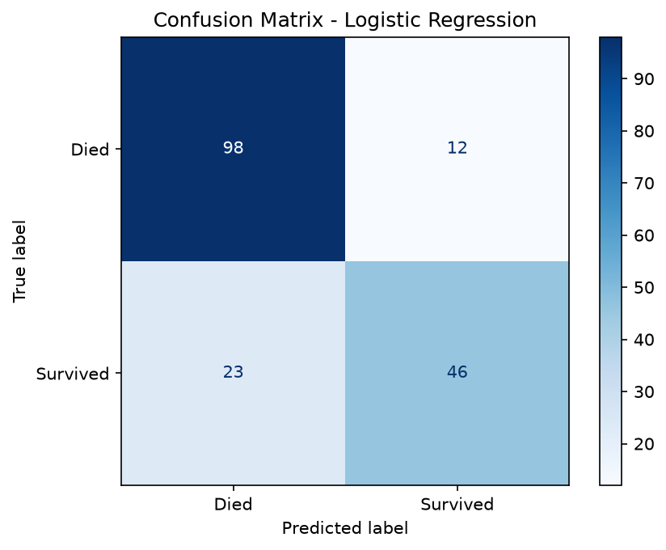
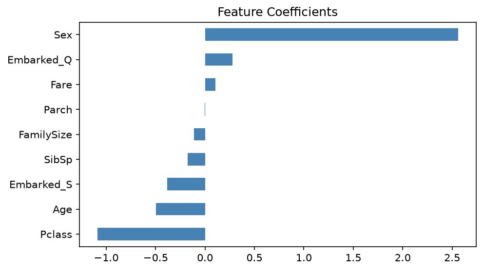

# Titanic Survival Prediction using Logistic Regression

A supervised machine learning project that predicts whether a Titanic passenger survived, using passenger class, sex, age, family size, fare and port of embarkation.

## Approach
- **Type:** Supervised learning, binary classification
- **Model:** Logistic Regression (scikit-learn)
- **Pipeline:** load data -> handle missing values (median Age, mode Embarked, drop Cabin) -> encode categorical features -> add `FamilySize` -> 80/20 stratified split -> scale numeric features -> train -> evaluate

## Results (test set, 179 passengers)
| Metric | Score |
|---|---|
| Accuracy | 0.804 |
| Precision | 0.793 |
| Recall | 0.667 |
| F1-score | 0.724 |

Key finding: `Sex` (female) is the strongest positive predictor of survival, and `Pclass` (lower class number = higher class) the strongest negative one, matching the "women and children first" and class-based access to lifeboats.




## Dataset
Titanic passenger data (891 records): https://www.kaggle.com/c/titanic

## How to run
```bash
pip install -r requirements.txt
python titanic_logreg.py
```

## Future work
Compare with Random Forest / SVM, add cross-validation and hyperparameter tuning.
